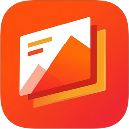
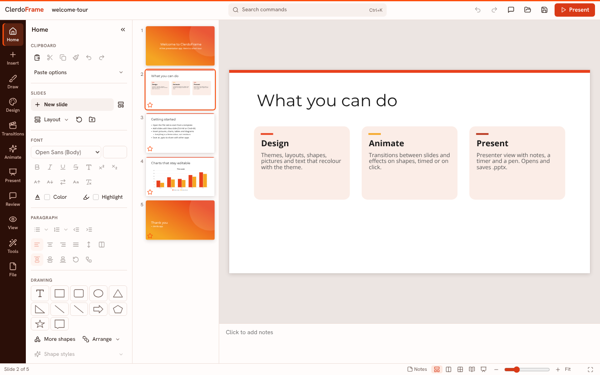
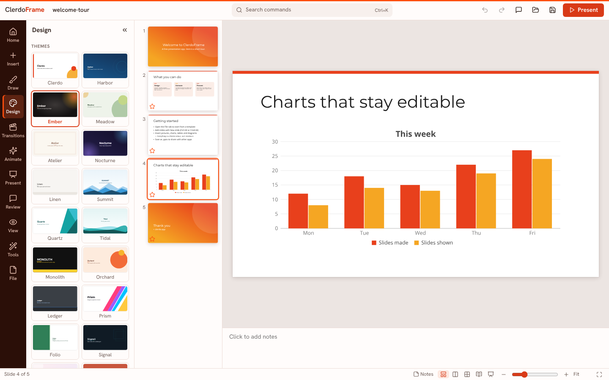
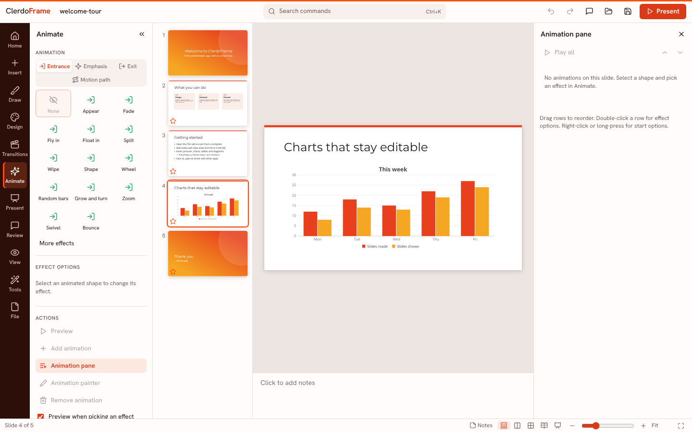
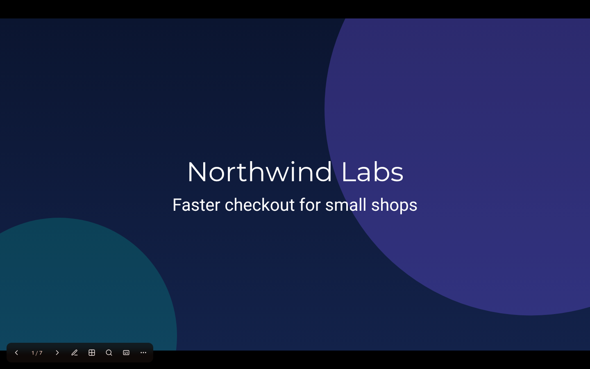
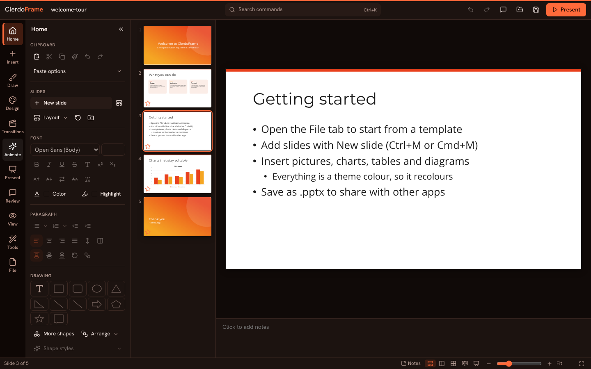
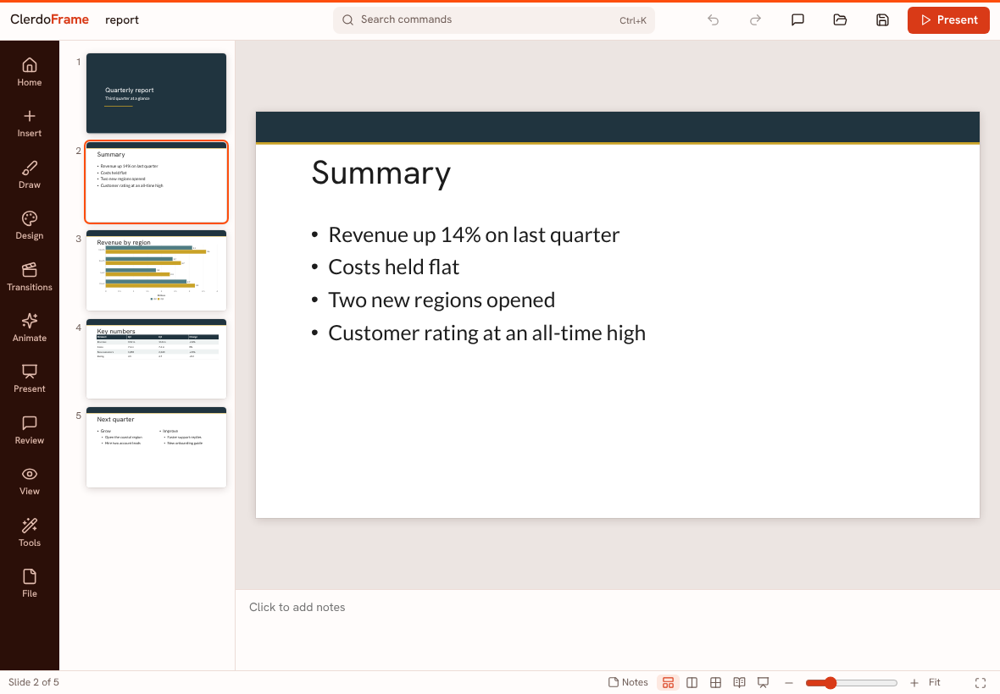

<p align="center"></p>

<h1 align="center">ClerdoFrame</h1>

<p align="center"><strong>A free, open-source presentation app by Clerdo.</strong><br>
Design slides, animate them and present, with your files staying on your own device.<br>Windows, macOS, Linux, iPad and the web.</p>

<p align="center">
<a href="https://clerdo.app">Website</a> ·
<a href="https://github.com/clerdoapp/clerdoframe/releases/latest">Download</a> ·
<a href="https://clerdoapp.github.io/clerdoframe/">Open in your browser</a> ·
<a href="LICENSE-MIT">MIT</a> / <a href="LICENSE-APACHE">Apache-2.0</a>
</p>

<p align="center"></p>

## What it does

- **Design:** 24 original themes with four colour variants each, 20 colour sets, 18 font pairs, background styles, slide sizes from widescreen to portrait, and **Design ideas**, which suggests other layouts for the slide you're on. Every colour is a theme colour, so changing the design recolours the whole deck.
- **Slide masters and layouts:** edit masters, layouts and placeholders, add your own layouts, keep several masters in one deck, and set up notes and handout masters.
- **Text:** every font setting (sizes, styles, spacing, case, highlight, super- and subscript), bullets and numbering at nine levels, line and paragraph spacing, columns, vertical and right-to-left text, text that shrinks or grows to fit, WordArt styles and text transforms, links and symbols.
- **Shapes:** all 187 standard preset shapes with adjustment handles, freeform and scribble drawing, connectors that stay glued, fills (solid, gradient, picture, pattern), outlines with arrowheads, shadows, glow and soft edges, 42 quick styles, grouping, alignment, distribution, rotation, flipping, a selection pane, smart guides, gridlines, rulers and guides.
- **Pictures and media:** insert, crop, recolour and adjust pictures, build photo albums, take screenshots, and add video and audio with trimming, fades and poster frames. Record audio or the screen straight into a slide.
- **Tables, charts and diagrams:** tables with 29 styles, merging and splitting; 19 chart types (column, bar, line, pie, doughnut, area, scatter, bubble, radar, stock, surface, combo, histogram, waterfall, funnel, treemap, sunburst, box and whisker, map) with an editable data grid; 20 diagram layouts for lists, processes, cycles, hierarchies, relationships, matrices and pyramids; equations; and a searchable library of about 1,500 icons.
- **Animate:** 47 transitions including Morph, 40 entrance effects with matching exits, 18 emphasis effects and motion paths, with triggers, timing, text by paragraph, word or letter, an animation pane and the animation painter.
- **Present:** full-screen slide shows with pen, highlighter and laser pointer, zoom, slide overview, black and white screens and live captions; a presenter view on a second screen with notes, the next slide and a timer; reading view; custom shows; rehearsed timings; recorded narration; slide, section and summary zooms.
- **Ink:** pens, pencil and highlighter with pressure, eraser, lasso, a ruler, ink to shape and ink replay. Works with Apple Pencil.
- **Review:** threaded comments with replies, spelling check, an accessibility check with quick fixes, find and replace, replace fonts, and mark as final.
- **Views:** normal, outline, slide sorter, notes page, reading view and the master views, with sections to organise long decks.
- **Files:** opens and saves `.pptx` (themes, masters, layouts, every shape kind, tables, charts, transitions, animations, notes, comments and sections), saves `.potx` templates and `.ppsx` shows, and exports PDF (slides, notes pages or handouts), PNG, JPEG, SVG, animated GIF, video, outline and `.odp`. Print with handout layouts. Details in [docs/file-formats.md](docs/file-formats.md).
- **Private:** no account, no server, no tracking. Nothing is sent anywhere.

<table>
<tr>
<td></td>
<td></td>
</tr>
<tr>
<td align="center">Design</td>
<td align="center">Animations</td>
</tr>
<tr>
<td></td>
<td></td>
</tr>
<tr>
<td align="center">Slide show</td>
<td align="center">Dark mode</td>
</tr>
<tr>
<td colspan="2" align="center"></td>
</tr>
<tr>
<td colspan="2" align="center">iPad</td>
</tr>
</table>

The full list, with what's finished and what's basic, is in [docs/FEATURES.md](docs/FEATURES.md). What's next is in [ROADMAP.md](ROADMAP.md). Sample presentations are in [examples/](examples/).

## Download

Get the latest build from the [Releases page](https://github.com/clerdoapp/clerdoframe/releases/latest):

| System | File |
|---|---|
| Windows | `.msi` installer, or the portable `.exe` / `.zip` |
| macOS | `.dmg` (Apple Silicon and Intel) |
| Linux | `.AppImage` (any distro), `.deb` (Ubuntu, Debian, Mint), `.rpm` (Fedora, openSUSE) or `.tar.gz` |
| iPad and web | Open [clerdoapp.github.io/clerdoframe](https://clerdoapp.github.io/clerdoframe/) in Safari, then **Share > Add to Home Screen** |

The builds aren't code-signed yet:

- **Windows:** in the SmartScreen warning, click **More info**, then **Run anyway**.
- **macOS:** right-click the app, choose **Open**, then **Open** again.
- **Linux AppImage:** make it executable first (`chmod +x`).

On iPad, the home-screen app works offline after the first visit and keeps a copy of unsaved work.

## Build from source

```bash
npm install
npm run dev       # web app at http://localhost:5173
npm test
npm run dist      # desktop installers for this system
npm run examples  # rebuild the sample presentations
```

More in [docs/development.md](docs/development.md), [docs/architecture.md](docs/architecture.md) and [docs/releasing.md](docs/releasing.md).

## Contributing

Read [CONTRIBUTING.md](CONTRIBUTING.md) and [AGENTS.md](AGENTS.md). Report security problems as described in [SECURITY.md](SECURITY.md).

## Licence

The code is available under either the [MIT License](LICENSE-MIT) or the [Apache License 2.0](LICENSE-APACHE), at your choice. Third-party material is listed in [NOTICE](NOTICE) and [ASSETS.md](ASSETS.md). ClerdoFrame's name and icon belong to Clerdo.
